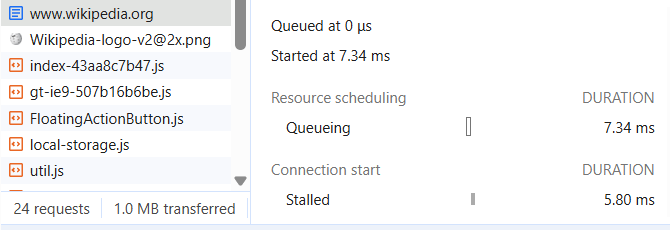
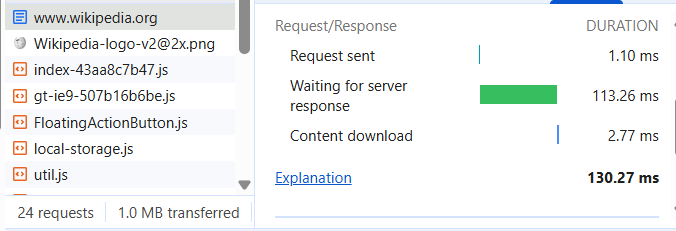

# Анализ архитектуры сайта Wikipedia

## 1. Цель работы

Изучить сетевые запросы сайта https://www.wikipedia.org/ с помощью инструментов разработчика Chrome и команды `curl`.

## 2. Анализ Network Waterfall

В инструментах разработчика Chrome на вкладке Network был открыт сайт Wikipedia. Для первого запроса изучены следующие фазы:

- **Queueing** — ожидание начала обработки запроса.
- **Stalled** — задержка перед отправкой запроса.
- **Request sent** — отправка запроса серверу.
- **Waiting for server response** — ожидание ответа сервера.
- **Content download** — загрузка содержимого ответа.

Время ожидания ответа сервера составило примерно 113 мс.

## 3. Анализ сетевых запросов

| Метод | Статус | Тип ресурса |
|---|---|---|
| GET | 304 | document |
| GET | 200 | image |
| GET | 200 | script |
| GET | 200 | script |
| GET | 200 | stylesheet |
| GET | 200 | image |
| GET | 200 | font |
| GET | 200 | image |
| GET | 200 | script |
| GET | 200 | stylesheet |

*Примечание: типы ресурсов и статусы в таблице необходимо сверить с фактическими запросами на вкладке Network.*

## 4. Проверка с помощью curl

Команда `curl -IL https://www.wikipedia.org/` была выполнена в командной строке Windows. В выводе обнаружен статус `HTTP/1.1 200 OK`. Это означает, что сервер успешно ответил на запрос. В полученном выводе цепочка перенаправлений не наблюдалась.

## 5. Схема архитектуры

Браузер пользователя → HTTPS-запрос → сервер Wikipedia → HTML-документ и дополнительные ресурсы (JavaScript, изображения, стили и шрифты) → отображение страницы в браузере.

## 6. Вывод

При загрузке Wikipedia браузер получает HTML-документ и загружает дополнительные ресурсы, включая JavaScript и изображения. Наличие HTML-документа и скриптов указывает на использование серверной выдачи HTML с дополнительной клиентской логикой. По одним только сетевым запросам нельзя полностью определить внутреннюю архитектуру сайта.
 week-1-report

Updated report for Week 1.
=======
## Screenshots

### 1. Network requests

### 2. Network requests

main
